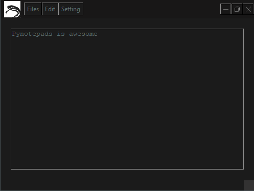

# PyNotepad

  

  <h3> A simple, open-source text editor built with Python </h3>

  

    A lightweight alternative to Notepad, built to explore Python's capabilities
    for working with text files and desktop applications.
  

---

## Table of Contents

- [About the Project](#about-the-project)
- [Screenshot](#screenshot)
- [Built With](#built-with)
- [Getting Started](#getting-started)
- [Usage](#usage)
- [Roadmap](#roadmap)
- [License](#license)
- [Acknowledgments](#acknowledgments)

## About the Project

**PyNotepad** is an open-source text editor developed in Python. The project was created as a way to explore how Python can be used to work with plain-text documents and build desktop applications.

The goal is to provide a simple text-editing experience while learning and experimenting with Python's GUI and file-handling capabilities.

### Project Goals

- Build a functional desktop text editor.
- Explore GUI development with Tkinter.
- Work with files and filesystem paths using `pathlib`.

## Screenshot

## Built With

PyNotepad is built using the following technologies:

- [Python](https://www.python.org/) — Core programming language.
- [Tkinter](https://docs.python.org/3/library/tkinter.html) — Desktop graphical user interface.
- [pathlib](https://docs.python.org/3/library/pathlib.html) — Filesystem path handling.

## Getting Started

### Prerequisites

The current release is distributed as a Windows executable.

- Windows
- A downloaded copy of PyNotepad

If you want to run the project from source, you will also need Python installed.

### Installation

1. Download or clone this repository.
2. Extract the downloaded archive if necessary.
3. Open the project folder.
4. Open the `main` folder.
5. Double-click `Pynotepad.exe` to launch the application.

## Usage

Launch `Pynotepad.exe` from the `main` folder to start using PyNotepad.

The application is designed as a straightforward text editor. Check the project for the features currently implemented in the latest version.

## Roadmap

Planned improvements and potential features:

- [x] Basic text editor
- [ ] Add caching
- [ ] Add line numbers and other editing features
- [ ] Add external component support
- [ ] Support Linux and macOS
- [ ] Add multilingual support
  - [ ] Chinese
  - [ ] Spanish

Suggestions and contributions are welcome. Roadmap items may change as the project develops.

## License

This project is distributed under the **GNU General Public License v3.0 (GPL-3.0)**, as indicated by the repository's license reference.

See the [repository license](https://github.com/b0rgborg/pynotepad) for the full terms.

## Acknowledgments

Resources that helped during development:

- [Stack Overflow](https://stackoverflow.com/questions)
- [Tkinter documentation](https://docs.python.org/3/library/tkinter.html)
- [Markdown Preview](https://harshkapadia2.github.io/preview-markdown/)

---

  Built with Python and a curiosity for learning.

